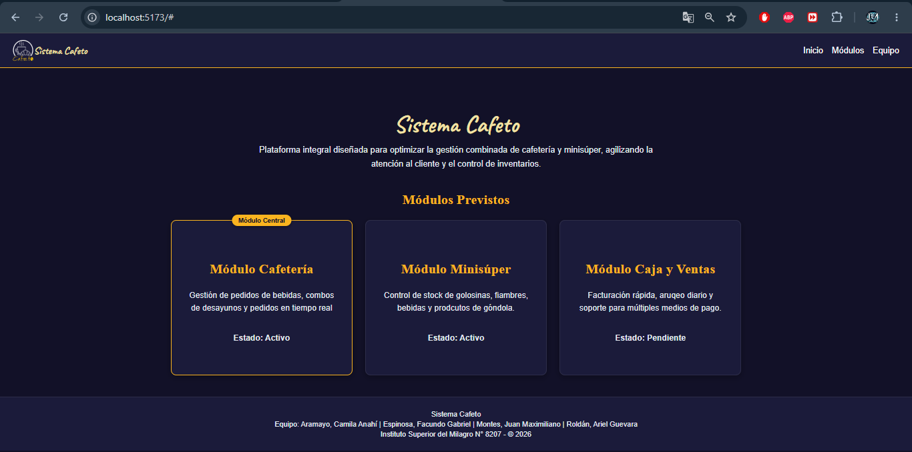

# Sistema Cafeto 
## Descripción 
Sistema Cafeto es una plataforma integral diseñada para optimizar la gestión combinada de cafetería y minisúper, agilizando la atención al cliente y el control de inventarios. 



## Integrantes
- Aramayo, Camila Anahí
- Espinosa, Facundo Gabriel 
- Montes, Juan Maximiliano 
- Roldán, Ariel Guevara

## Cómo levantar el sistema completo

El frontend (React + Vite) no tiene datos propios: todo lo pide a la API de Django
del proyecto **Proyecto-Cafeto**, que corre en Docker. Por eso hay que levantar
**primero el backend y después el frontend**.

### 1. Backend (Django en Docker)

En la carpeta de `Proyecto-Cafeto`:

```bash
docker compose up -d db web      # solo la base y Django (más liviano)
docker compose ps                # cafeto_db y cafeto_web tienen que figurar "running"
```

Comprobá que `http://localhost:8000` abra en el navegador. Para apagarlo: `docker compose stop`.

### 2. Frontend (este repositorio)

```bash
npm install      # solo la primera vez
npm run dev      # abre en http://localhost:5173
```

Se ingresa con el **mismo usuario (o DNI) y contraseña** de la web del sistema.

### ¿Hay que configurar algo en Django?

No. La API que se usa (`/api/movil/`) ya existe y está exenta de CSRF y del login
web. El único problema sería **CORS**: el navegador bloquea pedidos de
`localhost:5173` a `localhost:8000` porque son orígenes distintos. En lugar de
instalar `django-cors-headers` en el backend, `vite.config.js` define un
**proxy**: React le pide a `/api/...` al mismo servidor de Vite, y Vite reenvía el
pedido a Django. Para el navegador todo sale del mismo origen.

Si Django corre en otra dirección, se cambia sin tocar código creando un archivo
`.env.local` con `CAFETO_DJANGO_URL=http://otra-ip:8000`.

## Cómo está organizado

| Carpeta / archivo | Qué hace |
|---|---|
| `src/api/api.js` | Único lugar que habla con Django (instancia de Axios, token, mensajes de error). |
| `src/components/` | Piezas reutilizables: Navbar, Footer, Tarjeta, Confirmacion (modal), Cargando, AvisoError, RutaProtegida. |
| `src/pages/` | Una carpeta por pantalla: Login, Productos, Cajas, Usuarios, NoEncontrada. |
| `src/utils/formato.js` | Formato de pesos, números y búsqueda sin tildes. |
| `src/index.css` | Paleta oficial de Cafeto como variables CSS. |

### Decisiones importantes

- **Token**: Django firma un token al iniciar sesión y lo espera en cada pedido
  como `Authorization: Token <token>`. Lo agrega un *interceptor* de Axios.
- **Sesión vencida**: si Django responde 401 (el token venció a las 12 h, o la
  persona entró desde otro dispositivo), el interceptor borra la sesión y avisa a
  la app, que vuelve al login con un mensaje.
- **Cerrar sesión** pide confirmación y además revoca el token en Django
  (`DELETE /api/movil/sesion/`), no solo lo borra del navegador.
- **Rutas protegidas**: `RutaProtegida` envuelve las páginas internas; sin sesión
  manda al login y, después de entrar, devuelve a la página que se quería ver.
- **Navbar**: llama a `useLocation()` para volver a dibujarse en cada cambio de
  página y así enterarse de si hay o no sesión.
- **Productos**: la búsqueda filtra al instante lo que ya está cargado y, 400 ms
  después de dejar de escribir, le pide a Django que busque en todo el catálogo
  (la API devuelve de a 20 productos; "Ver más productos" trae la página siguiente).
- **Cajas y Usuarios**: la API no tiene un listado de cajas ni de usuarios. Cajas
  muestra el panel del día (`/api/movil/panel/`); abrir, arquear y cerrar caja, y
  el ABM de usuarios, se hacen desde la web de Django, que es donde quedan
  auditados.

## Comandos útiles

- `npm run dev`: servidor de desarrollo.
- `npm run lint`: revisa el código con oxlint.
- `npm run build` y `npm run preview`: versión de producción (el proxy también funciona en `preview`).
